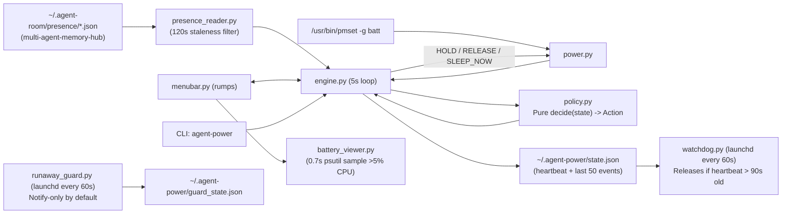

# agent-aware-power-manager

A macOS menu-bar power manager that keeps your Mac awake with the lid closed while any AI agent in your [`multi-agent-memory-hub`](https://github.com/Bjay4910/multi-agent-memory-hub) room is working, and lets macOS sleep normally once they finish.

## The Three Rules

1. **Lid closed while an agent works stays awake:** When any agent in the room reports `"status": "working"`, the engine acquires a clamshell sleep hold (`pmset -a disablesleep 1`) so closing the lid does not interrupt active work.
2. **Agents finish and it sleeps normally within about 20 seconds:** Once the last working agent transitions to `"idle"` (or its heartbeat goes stale after 120 seconds), the engine waits a 20-second grace period for follow-up tasks and then releases the hold (`pmset -a disablesleep 0`).
3. **Sleep now always works:** Clicking **Sleep now** in the menu bar (or running `agent-power sleep-now`) overrides every mode and active agent, releases the sleep hold first, and puts the Mac to sleep immediately (`pmset sleepnow`).

## Architecture



## Connecting to `multi-agent-memory-hub` (Presence Contract)

`agent-aware-power-manager` reads presence files written by [`multi-agent-memory-hub`](https://github.com/Bjay4910/multi-agent-memory-hub) at `~/.agent-room/presence/<agent>.json` (override the base directory with `AGENT_ROOM_HOME`):

```json
{
  "agent": "claude",
  "status": "working",
  "task": "compare databases",
  "pid": 48210,
  "updated_at": "2026-11-17T18:45:00Z"
}
```

- **Allowed fields:** Only `agent`, `status` (`"working"` or `"idle"`), `task` (short text), `pid`, and `updated_at` (ISO 8601 UTC) are read. No prompt content is ever read.
- **120-second staleness rule:** Any `"working"` entry whose `updated_at` timestamp is older than 120 seconds is treated as stale and counts as `"idle"`.
- **Resilience:** Missing directories, unreadable files, and malformed JSON files are silently ignored.

## Safety Rails

- **Only while plugged in (ON by default):** On battery power, your Mac behaves like a normal laptop unless you explicitly uncheck **"Only while plugged in"** in the menu bar.
- **Battery floor (25%) and critical cutoff (10%):** Even if unplugged holds are enabled, no new sleep hold is ever started below **25% battery**, and at **10% or less on battery**, the policy forces immediate sleep (`SLEEP_NOW`).
- **2-hour maximum hold:** Any continuous hold automatically releases after **2 hours** (7200 seconds).
- **20-second idle grace period:** Prevents rapid toggling between back-to-back agent steps before releasing the hold.
- **Exit & crash protection (`watchdog.py`):** The engine releases its hold on normal exit and `SIGTERM`/`SIGINT`. In addition, `watchdog.py` runs every 60 seconds from `launchd`; if `disablesleep` is active and the engine heartbeat in `~/.agent-power/state.json` is older than **90 seconds**, the watchdog releases the hold and logs the recovery.
- **Using the battery viewer (`battery_viewer.py`):** Samples CPU twice 0.7 seconds apart with `psutil` on demand and lists only your own processes using above 5% CPU in plain words (what it is, working folder, listening ports, and parent process). Offers a confirmed **Quit** action (`SIGTERM`, then `SIGKILL` after 5 seconds). Never touches system processes, other users' processes, itself, or the room.
- **Notify-first runaway script guard (`runaway_guard.py`):** Runs once a minute and acts **only** when all six conditions hold:
  1. The process belongs to your user.
  2. Its parent is `launchd` (`ppid == 1`).
  3. It is a script interpreter (`python`, `node`, `ruby`, `perl`, `bash`, `zsh`, `sh`, `deno`, `bun`, `php`).
  4. It listens on **no** network port.
  5. No line in `~/.config/agent-power/allow` matches its command line as a substring.
  6. It used at least **80% of one core** in every check for **10 minutes straight** (tracked via CPU time deltas in `~/.agent-power/guard_state.json`).
  - **Default behavior is notify-only:** Sends a macOS notification via `osascript` naming the process and folder, and logs to `~/.local/state/agent-power/guard.log`.
  - **Optional auto-stop:** Only if `"guard": {"auto_stop": true}` is set in `~/.config/agent-power/config.json` does it send `SIGTERM` and then `SIGKILL` after 5 seconds.
  - **Kill switch:** Create `~/.config/agent-power/guard_disabled` to disable the guard completely.

## Limits (Honest Trade-offs)

1. **`pmset disablesleep` blocks the standard Apple Sleep menu item and power button:** To keep a MacBook awake with the lid closed on macOS, `/usr/bin/pmset -a disablesleep 1` disables system sleep globally while the hold is active. During a hold, choosing **Apple menu -> Sleep** or pressing the power button will not put the Mac to sleep. Use **"Sleep now"** in the Agent Power menu bar (or `agent-power sleep-now`), which releases `disablesleep` first and then calls `pmset sleepnow`.
2. **Behavior on battery:** By default, **"Only while plugged in"** is enabled, so unplugging the power adapter immediately releases any hold and lets the laptop sleep when closed. If you uncheck **"Only while plugged in"**, holds are allowed on battery down to 25% for new holds, and the Mac forces sleep at 10% battery.
3. **Narrow passwordless `sudo` rule required:** Toggling `pmset -a disablesleep` requires root privileges on macOS. `scripts/install.sh` installs `/etc/sudoers.d/agent-power` (validated with `visudo -cf` before placement) granting your macOS user passwordless permission to run **only** two exact commands:
   - `/usr/bin/pmset -a disablesleep 0`
   - `/usr/bin/pmset -a disablesleep 1`
   No other `pmset` flags or commands are allowed by the sudoers rule.

## CLI Usage (`agent-power`)

```bash
agent-power status               # Show hold state, battery, active agents, and last 5 events
agent-power hold                 # Enable 'Hold 2 hours' mode
agent-power release              # Release any active sleep hold immediately
agent-power sleep-now            # Release hold and put the Mac to sleep immediately
agent-power mode auto            # Set mode to Automatic (auto | hold | off)
agent-power guard-run            # Run the runaway script guard check once
agent-power guard-status         # Inspect tracked background scripts and guard log
```

Set `AGENT_POWER_DRY_RUN=1` to test any command without root or real `pmset` changes (prints the `pmset` commands instead of running them).

## Manual Installation & Uninstallation

### Install

Review and run the installer yourself from your terminal:

```bash
./scripts/install.sh
```

`scripts/install.sh` will:
1. Create `.venv` and install `agent-aware-power-manager`.
2. Write the three LaunchAgents (`com.agentpower.menubar.plist`, `com.agentpower.watchdog.plist`, `com.agentpower.guard.plist`) to `~/Library/LaunchAgents/`.
3. Display the exact `/etc/sudoers.d/agent-power` rule, ask for confirmation, validate it with `sudo visudo -cf`, install it with mode `0440`, and load the LaunchAgents.

### Uninstall

```bash
./scripts/uninstall.sh
```

`scripts/uninstall.sh` releases any active sleep hold, unloads and deletes the three LaunchAgents, removes `/etc/sudoers.d/agent-power` (with confirmation), and cleans up `~/.agent-power`, `~/.config/agent-power`, and `~/.local/state/agent-power`.

## Credits

Inspired by Agent Awake by a7ussein.

## License

MIT License — Copyright (c) 2026 Barnabas James Gyampoh.
