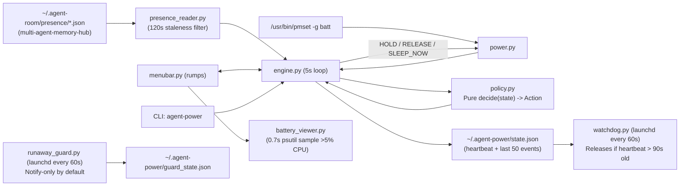

# agent-aware-power-manager

A macOS menu-bar power manager that keeps your Mac awake with the lid closed while any AI agent in your [`multi-agent-memory-hub`](https://github.com/Bjay4910/multi-agent-memory-hub) room is working, and lets macOS sleep normally once they finish.

## The Three Rules

1. **Lid closed while an agent works stays awake:** In **Automatic** mode, when any agent in the room reports `"status": "working"` — including **Claude Code** and **Antigravity CLI (`agy`)** turns via lifecycle hooks, plus background commands started during the turn that outlive turn end — the engine acquires a clamshell sleep hold (`pmset -a disablesleep 1`) so closing the lid does not interrupt active work.
2. **Agents finish and it sleeps normally within about 20 seconds:** Once the last working agent (and any background commands it started during the turn) finishes or goes stale after 120 seconds, the engine waits a 20-second grace period for follow-up tasks and then releases the hold (`pmset -a disablesleep 0`).
3. **Sleep now always works:** Clicking **Sleep now** in the menu bar (or running `agent-power sleep-now`) overrides every mode and active agent, releases the sleep hold first, and puts the Mac to sleep immediately (`pmset sleepnow`).

## Menu Bar Icon & Notch Tip

- The menu bar uses compact emoji-only icons: `⚡` (awake), `🌙` (normal), `⏸` (off), and `⚠️` (problem).
- Click the icon to see the **`Status:`** line at the top of the menu (for example `Status: Awake` or `Status: Normal`) in plain words.
- **MacBook notch tip:** On notched MacBooks, if the menu bar is crowded the icon can get hidden behind the notch. Free up menu bar space (quit or hide unused menu bar icons) or switch Display scaling to **More Space** in System Settings.
- **Hidden-icon warning:** The menu bar app checks whether its status item is visible (`NSStatusItem` occlusion state) and skips checks while the screen is locked, asleep, or in full-screen. If the icon stays hidden across 3 consecutive checks spanning at least 30 seconds, it sends a one-time macOS notification (re-armed only after the icon becomes visible again) and reports the state to `agent-power doctor`.

## Claude Code & Antigravity CLI Lifecycle Hooks

To have **Automatic** mode track **Claude Code** and **Antigravity CLI (`agy`)** turns automatically:

```bash
agent-power install-hooks --print   # Preview the exact JSON snippets (makes no changes)
agent-power install-hooks --apply   # Back up existing configs and merge hooks safely
agent-power uninstall-hooks         # Back up configs and remove only agent-power hooks
```

- While a turn is running, a lightweight per-session heartbeat refreshes `~/.agent-room/presence/<session>.json` every 30 seconds (no prompt text is ever read or logged).
- If the agent ends its turn (`Stop`) while a background command started during that turn is still running as a descendant of the agent process, the hold stays active until those background commands exit (still bounded by the 2-hour cap and all battery safety rails). Older pre-turn children like MCP servers or language servers are ignored.

## Architecture



## Connecting to `multi-agent-memory-hub` (Presence Contract)

`agent-aware-power-manager` reads presence files written by [`multi-agent-memory-hub`](https://github.com/Bjay4910/multi-agent-memory-hub) at `~/.agent-room/presence/<agent>.json` (override the base directory with `AGENT_ROOM_HOME`):

```json
{
  "agent": "claude",
  "status": "working",
  "task": "compare databases",
  "pid": 48210,
  "updated_at": "2026-11-17T18:45:00Z"
}
```

- **Allowed fields:** Only `agent`, `status` (`"working"` or `"idle"`), `task` (short text), `pid`, and `updated_at` (ISO 8601 UTC) are read. No prompt content is ever read.
- **120-second staleness rule:** Any `"working"` entry whose `updated_at` timestamp is older than 120 seconds is treated as stale and counts as `"idle"`.
- **Resilience:** Missing directories, unreadable files, and malformed JSON files are silently ignored.

## Safety Rails

- **Only while plugged in (ON by default):** On battery power, your Mac behaves like a normal laptop unless you explicitly uncheck **"Only while plugged in"** in the menu bar.
- **Battery floor (25%) and critical cutoff (10%):** Even if unplugged holds are enabled, no new sleep hold is ever started below **25% battery**, and at **10% or less on battery**, the policy forces immediate sleep (`SLEEP_NOW`).
- **2-hour maximum hold:** Any continuous hold automatically releases after **2 hours** (7200 seconds).
- **20-second idle grace period:** Prevents rapid toggling between back-to-back agent steps before releasing the hold.
- **Exit & crash protection (`watchdog.py`):** The engine releases its hold on normal exit and `SIGTERM`/`SIGINT`. In addition, `watchdog.py` runs every 60 seconds from `launchd`; if `disablesleep` is active and the engine heartbeat in `~/.agent-power/state.json` is older than **90 seconds**, the watchdog releases the hold and logs the recovery.
- **Using the battery viewer (`battery_viewer.py`):** Samples CPU twice 0.7 seconds apart with `psutil` on demand and lists only your own processes using above 5% CPU in plain words (what it is, working folder, listening ports, and parent process). Offers a confirmed **Quit** action (`SIGTERM`, then `SIGKILL` after 5 seconds). Never touches system processes, other users' processes, itself, or the room.
- **Notify-first runaway script guard (`runaway_guard.py`):** Runs once a minute and acts **only** when all six conditions hold:
  1. The process belongs to your user.
  2. Its parent is `launchd` (`ppid == 1`).
  3. It is a script interpreter (`python`, `node`, `ruby`, `perl`, `bash`, `zsh`, `sh`, `deno`, `bun`, `php`).
  4. It listens on **no** network port.
  5. No line in `~/.config/agent-power/allow` matches its command line as a substring.
  6. It used at least **80% of one core** in every check for **10 minutes straight** (tracked via CPU time deltas in `~/.agent-power/guard_state.json`).
  - **Default behavior is notify-only:** Sends a macOS notification via `osascript` naming the process and folder, and logs to `~/.local/state/agent-power/guard.log`.
  - **Optional auto-stop:** Only if `"guard": {"auto_stop": true}` is set in `~/.config/agent-power/config.json` does it send `SIGTERM` and then `SIGKILL` after 5 seconds.
  - **Kill switch:** Create `~/.config/agent-power/guard_disabled` to disable the guard completely.

## Limits (Honest Trade-offs)

1. **`pmset disablesleep` blocks the standard Apple Sleep menu item and power button:** To keep a MacBook awake with the lid closed on macOS, `/usr/bin/pmset -a disablesleep 1` disables system sleep globally while the hold is active. During a hold, choosing **Apple menu -> Sleep** or pressing the power button will not put the Mac to sleep. Use **"Sleep now"** in the Agent Power menu bar (or `agent-power sleep-now`), which releases `disablesleep` first and then calls `pmset sleepnow`.
2. **Behavior on battery:** By default, **"Only while plugged in"** is enabled, so unplugging the power adapter immediately releases any hold and lets the laptop sleep when closed. If you uncheck **"Only while plugged in"**, holds are allowed on battery down to 25% for new holds, and the Mac forces sleep at 10% battery.
3. **Narrow passwordless `sudo` rule required:** Toggling `pmset -a disablesleep` requires root privileges on macOS. `scripts/install.sh` installs `/etc/sudoers.d/agent-power` (validated with `visudo -cf` before placement) granting your macOS user passwordless permission to run **only** two exact commands:
   - `/usr/bin/pmset -a disablesleep 0`
   - `/usr/bin/pmset -a disablesleep 1`
   No other `pmset` flags or commands are allowed by the sudoers rule.
4. **Detached/non-child background processes are not tracked:** At turn end (`Stop`), the hook only keeps the hold alive for background commands that are descendants (children/grandchildren) of the agent process and started during that turn. A background process the agent triggers that is **not** a child of the agent process (for example, a job handed off to an external daemon or `launchd` before `Stop`) is not tracked.

## CLI Usage (`agent-power`)

```bash
agent-power doctor                  # Read-only health check (LaunchAgents, sudoers, hooks, presence, icon)
agent-power status                  # Show hold state, battery, active agents, and last 5 events
agent-power hold                    # Enable 'Hold 2 hours' mode
agent-power release                 # Release any active sleep hold immediately
agent-power sleep-now               # Release hold and put the Mac to sleep immediately
agent-power mode auto               # Set mode to Automatic (auto | hold | off)
agent-power install-hooks --print   # Print Claude Code & Antigravity hook JSON snippets
agent-power install-hooks --apply   # Backup and merge lifecycle hooks into agent configs
agent-power uninstall-hooks         # Backup and remove lifecycle hooks from agent configs
agent-power guard-run               # Run the runaway script guard check once
agent-power guard-status            # Inspect tracked background scripts and guard log
```

Set `AGENT_POWER_DRY_RUN=1` to test any command without root or real `pmset` changes (prints the `pmset` commands instead of running them). Set `AGENT_POWER_MAX_HOLD_SECONDS=<seconds>` to shorten the 2-hour (7200s) hold cap for short-timeout testing (clamped to a maximum of 7200s; unset or invalid values keep the 7200s default).

## Manual Installation & Uninstallation

### Install

Review and run the installer yourself from your terminal:

```bash
./scripts/install.sh
```

`scripts/install.sh` will:
1. Create `.venv` and install `agent-aware-power-manager`.
2. Write the three LaunchAgents (`com.agentpower.menubar.plist`, `com.agentpower.watchdog.plist`, `com.agentpower.guard.plist`) to `~/Library/LaunchAgents/`.
3. Display the exact `/etc/sudoers.d/agent-power` rule, ask for confirmation, validate it with `sudo visudo -cf`, install it with mode `0440`, and load the LaunchAgents.

### Uninstall

```bash
./scripts/uninstall.sh
```

`scripts/uninstall.sh` releases any active sleep hold, unloads and deletes the three LaunchAgents, removes `/etc/sudoers.d/agent-power` (with confirmation), and cleans up `~/.agent-power`, `~/.config/agent-power`, and `~/.local/state/agent-power`.

## Running the tests

Create a virtual environment, install the package with its `dev` extra, and run `pytest`:

```bash
python3 -m venv .venv
.venv/bin/pip install -e ".[dev]"
.venv/bin/python -m pytest -q
```

## Verification

- **Original lid-closed test:** I closed the laptop lid for about 5 minutes with an agent presence file reported as working, while the Mac was plugged in. A timestamp logged every 5 seconds produced 60 entries with no gaps over 8 seconds. Repeated once with the same result (two runs total). After each run the hold was released (`pmset -g` showed `SleepDisabled 0`).
- **Real background-command E2E tests (plugged in, lid open):** Verified on both Antigravity CLI (`agy`) and Claude Code (`claude -p` in stream-json mode) with a 65-second background command outliving `Stop`: the session presence file stayed `"working"` (`waiting_for_children: true`) and `pmset -g` stayed `SleepDisabled 1` until the command exited, then removed the file and returned to `SleepDisabled 0` after the 20-second grace period.
- **Lid-closed with lifecycle hooks (plugged in, one run):** On my MacBook Pro, a real Claude Code session started a 4-minute background command (a loop writing a timestamp every 5 seconds to a log) and ended its turn. I closed the lid; the log had 48 entries with no gap over 8 seconds, and `SleepDisabled` was `0` afterwards. One run only.
- **Lid-closed with lifecycle hooks (on battery, one run):** On my MacBook Pro, unplugged with **"Only while plugged in"** unticked (battery at 62% at the end), the same 4-minute timestamp-loop test produced 48 entries with no gaps, and `SleepDisabled` was back to `0` about a minute after the command finished. One run only (no battery drain numbers or longer durations verified).
- **Antigravity desktop IDE hooks (Nov 20, 2026, ~3:37–3:38 AM, one run):** Verified on my MacBook Pro that the Antigravity desktop IDE fired the same lifecycle hooks: an `agy-<id>.json` presence file appeared, `SleepDisabled` became `1`, and it released back to `0` afterward. Desktop IDE chats are not captured by the room (`antigravity:outside-brain`; belongs to `multi-agent-memory-hub`).
- **Automated fixture & fake-clock tests (not real battery drain or real-time clock shifts):** Battery thresholds (`<=10%` forced sleep, below 25% new holds refused, 25–100% holds allowed, AC vs battery, and fail-safe on unreadable `pmset -g batt`), clock edge cases (DST spring-forward/fall-back, backwards wall-clock jumps, midnight crossings, 2-hour monotonic cap, and 120s stale presence expiry), and `AGENT_POWER_MAX_HOLD_SECONDS` (default 7200s, clamped to <=7200s) are covered in `tests/`.
- **Not yet tested:**
  - Full 2-hour cap in real time (verified with fake clocks and `AGENT_POWER_MAX_HOLD_SECONDS` in automated tests)
  - Other Mac models
  - Real hardware battery drain below 25% and real-time DST transitions (covered with fixtures and fake clocks only)

## Credits

Inspired by Agent Awake by a7ussein.

## License

MIT License — Copyright (c) 2026 Barnabas James Gyampoh.
